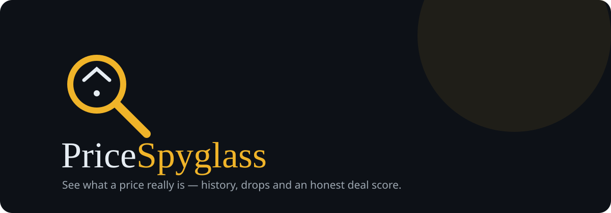
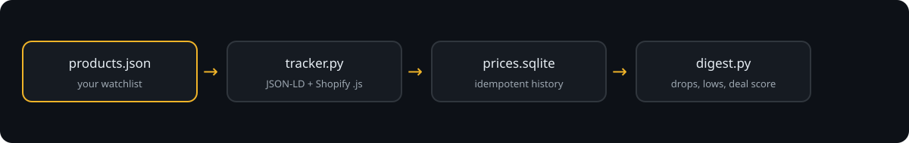

# PriceSpyglass



<p>
  
  
  
  
</p>

**A tiny, store-agnostic price tracker with a memory.** List the products you care about, run one script, and PriceSpyglass keeps an honest price history in a single SQLite file — then tells you, every day, what genuinely got cheaper: biggest drops, 30-day lows, and a **deal score** that separates a real bargain from a fake "70% OFF" on an inflated list price.

No account. No API keys. No Docker. Python standard library only.



## Why another price tracker?

- Hosted trackers (Keepa and friends) cover big marketplaces, not the independent stores where you actually shop — and your watchlist lives on their servers.
- Most open-source trackers are heavy apps or single-store scrapers.
- Almost none of them answer the only question that matters: **is this price actually good?** A deal score needs history — so PriceSpyglass builds the history first, then scores against it.

## Quick start

```bash
git clone https://github.com/iSahinul/PriceSpyglass.git
cd PriceSpyglass
cp products.example.json products.json   # edit it: your products, your stores
python3 tracker.py                       # fetch current prices into prices.sqlite
python3 digest.py                        # write today's digest to digests/
```

Run `tracker.py` on a schedule (cron, Task Scheduler) and `digest.py` after it. That is the whole system.

## Your watchlist: products.json

```json
[
  {
    "key": "my-grinder",
    "name": "The grinder I want",
    "store": "store.example.com",
    "url": "https://store.example.com/products/grinder",
    "via": "jsonld"
  }
]
```

Two fetch paths, picked per product with `via`:

| via | How it reads the price | Use it for |
|---|---|---|
| `jsonld` | The page's schema.org JSON-LD `Product` block (`offers.price`) | Any store whose product pages ship structured data — most modern themes do |
| `shopify` | The store's public `/products/<handle>.js` endpoint (first variant: price, compare-at price, availability) | Any Shopify store — no API key, no app |

Fetching is polite: sequential, a normal browser user-agent, 2 seconds between products (`PT_DELAY` to change). **If a price cannot be read, nothing is recorded.** Prices are never guessed, interpolated or carried over.

## The digest

```markdown
## Top 5 price drops (7d)
- **Burr Grinder** (store.example.com): 5,000 -> 3,900 (**-22.0%**) - score 71

## At 30-day low
- **Burr Grinder** (store.example.com): 3,900 - score 71
```

A full sample generated from synthetic data: [examples/sample-digest.md](examples/sample-digest.md).

## The deal score (0–100)

| Component | Points | Meaning |
|---|---|---|
| Discount depth | 40 | How far below the list (compare-at) price, capped at 60% off |
| Vs 30-day low | 40 | At the lowest price of the month = full marks |
| Vs 30-day average | 20 | How far below what it usually costs |

A product can show a huge discount and still score low — if it has been cheaper before, the score knows. That is the whole point of keeping history.

## Configuration

| Variable | Default | Purpose |
|---|---|---|
| `PT_PRODUCTS` | `./products.json` | Watchlist file |
| `PT_DB` | `./prices.sqlite` | History database |
| `PT_DELAY` | `2` | Seconds between fetches |
| `PT_CURRENCY` | *(none)* | Symbol prefixed in the digest, e.g. `₹` or `$` |

## Design rules

- **Standard library only** — nothing to install, nothing to break.
- **Idempotent history** — re-running a fetch in the same minute stores nothing twice (`UNIQUE(product_key, checked_at, source)`).
- **Unknown means absent** — a failed fetch is a gap in the graph, never a copied or invented number.
- **One file is the memory** — back up `prices.sqlite` and you have backed up everything.

## Give it to your AI

Paste this into Claude, ChatGPT or Codex and let your assistant do the setup:

```text
Set up PriceSpyglass from this repo. Read skill/SKILL.md first. Ask me
which products and stores I want to track, build my products.json with
the right fetch path for each one, run the tracker, and show me the
first digest. If a price cannot be read, tell me - never guess one.
```

## Use it as an agent skill

This repo ships a `SKILL.md` (in the `skill/` folder) in the open Agent Skills format — the same file works in Claude, ChatGPT and Codex. Install the skill and your AI assistant learns the discipline on its own: how to add products, which fetch path to pick, and why a price is never guessed.

Copy the `skill/` folder into your agent's skills directory (for example `~/.claude/skills/pricespyglass/` or `~/.agents/skills/pricespyglass/`), keeping `SKILL.md` inside it.

## Roadmap

- Static HTML dashboard with sparklines (the history is already there)
- Optional alert hooks (Telegram / email) when a product crosses a target price or hits a new low
- More fetch paths for stores without JSON-LD

## Common questions

**Does it work for Amazon?**
Amazon blocks simple page fetches, so the `jsonld` path usually cannot read it directly. PriceSpyglass is built for independent and Shopify stores, where your watchlist is yours. Marketplace coverage may come later through public tracker pages.

**Is scraping stores okay?**
PriceSpyglass reads public product pages politely — one request per product, seconds apart, no logins, no bypassing anything. Keep your list small and your schedule sane (daily is plenty), and check each store's terms if you plan to run it at scale.

**Why SQLite and not a "real" database?**
Because a price history for a personal watchlist is a few thousand rows a year. One file, zero setup, trivial backups — the boring choice is the right one.

## What has been tested

Covered by unit tests (JSON-LD parsing, Shopify payloads, storage idempotency, deal-score maths) and an end-to-end digest run on a synthetic 30-day history - see `examples/sample-digest.md`. The fetch paths come from a production price-intelligence system that polls real stores daily; this public extraction is new, so store-specific quirks may surface. Reports are welcome.

## About the creator

**Built by Sahinul Islam Laskar** — I run content sites and the automation behind them: SEO measurement, price tracking and deal monitoring. PriceSpyglass is the tracking core from a live price-intelligence system that watches coffee gear prices across marketplaces and brand stores every day, extracted and open-sourced because fake discounts are everybody's problem.

[GitHub](https://github.com/iSahinul) · [LinkedIn](https://www.linkedin.com/in/isahinul/) · [X (@iSahinul)](https://x.com/iSahinul)

## License

MIT — see [LICENSE](LICENSE).
